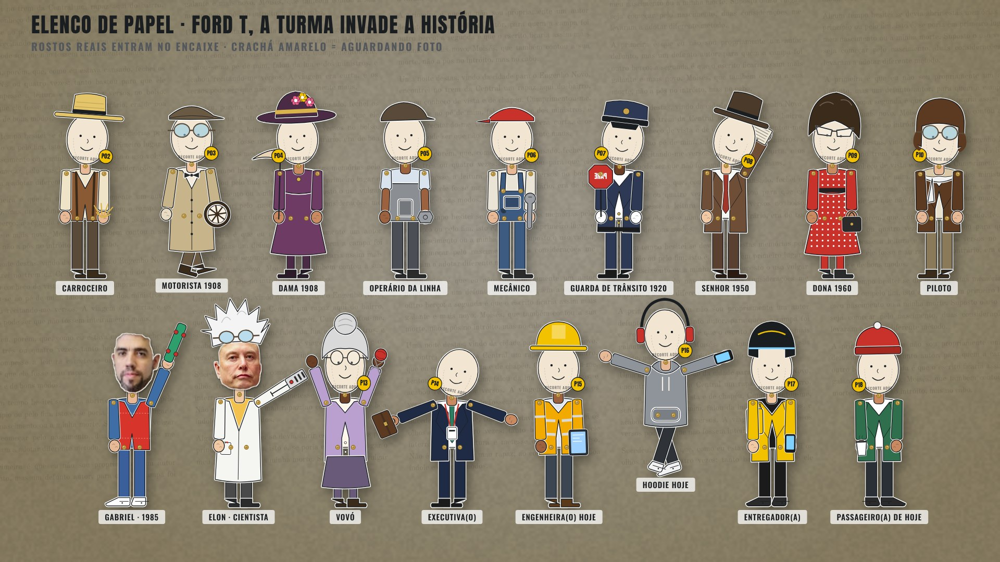

# Elenco de papel — personagens do vídeo "Ford T"

Bonecos de papel articulados (estilo recorte de revista com colchetes de latão), gerados por código em
[`producao/comp/puppet.js`](../../../producao/comp/puppet.js). Cada boneco tem **encaixe de rosto**: enquanto a foto
do participante não chega, o encaixe mostra uma cara de papel com o crachá amarelo do código (P02…P18).



## Figurinos disponíveis (18)

| Chave | Figurino | Época / uso na história | Adereço |
|---|---|---|---|
| `carroceiro` | Carroceiro | Era das carroças | feno |
| `motorista1908` | Motorista 1908 | Primeiros Ford T (óculos de proteção, boné) | volante |
| `dama1908` | Dama 1908 | Rua de 1908 | sombrinha |
| `fordista` | Operário da linha | Linha de montagem | parafuso |
| `mecanico` | Mecânico | "Como liga isso?" | chave inglesa |
| `guarda` | Guarda de trânsito 1920 | Nascimento das regras | placa PARE |
| `senhor1950` | Senhor 1950 | Décadas / rádio | jornal |
| `dona1960` | Dona 1960 | Décadas / cidade cresce | bolsa |
| `piloto` | Piloto | Carro voador | cachecol |
| `marty1985` | Jovem 1985 (**Gabriel · P01**) | Dupla-paródia da viagem no tempo | skate |
| `doc` | Cientista (**Elon**) | Dupla-paródia / carro voador | controle remoto |
| `vovo` | Vovó | Reação à novidade | tricô |
| `executivo` | Executiva(o) | Hoje | maleta |
| `engenheiro_hoje` | Engenheira(o) hoje | Hoje / futuro | tablet |
| `hoodie_hoje` | Hoodie hoje | Hoje / app | celular |
| `entregador` | Entregador(a) | Hoje / trânsito | celular |
| `passageiro` | Passageiro(a) de hoje | Hoje / trânsito | café |

Poses prontas: `puppetIdle`, `puppetWalk`, `puppetWave`, `puppetNod`, `puppetPoint`, `puppetShrug`,
`puppetFacepalm`, `puppetJump`, `puppetScared`. Qualquer articulação (cabeça, braços, pernas, tronco) aceita
keyframes do motor.

## Especificação das fotos dos participantes

- **Rosto com pelo menos 400 px de altura** (ideal ≥ 800 px). A foto do Gabriel chegou com 81 × 105 px e por isso
  aparece borrada no elenco v1 — basta reenviar em resolução maior.
- Frontal ou levemente de 3/4, olhando para a câmera, **expressão neutra ou sorrindo** (a expressão vira a
  "cara padrão" do boneco).
- Fundo qualquer: o recorte é automático (`producao/face_prep.py`, cabelo + rosto + pescoço).
- Sem óculos escuros; óculos de grau podem.
- Nome do arquivo: `imagens/pessoas/participantes/<primeiro-nome>.png` (sem e-mail, sem sobrenome completo).
- **Só entram rostos autorizados** (autorização de todos confirmada pelo solicitante em 19/10/2026).

## Como um rosto entra no boneco

```
python3 producao/face_prep.py imagens/pessoas/participantes/gabriel.png out/img/faces/gabriel.png --size 480
```
Saída: PNG RGBA (cabeça com borda de papel branca e sombra), usado como `face: IMG.faces_gabriel` em `puppet()`.
