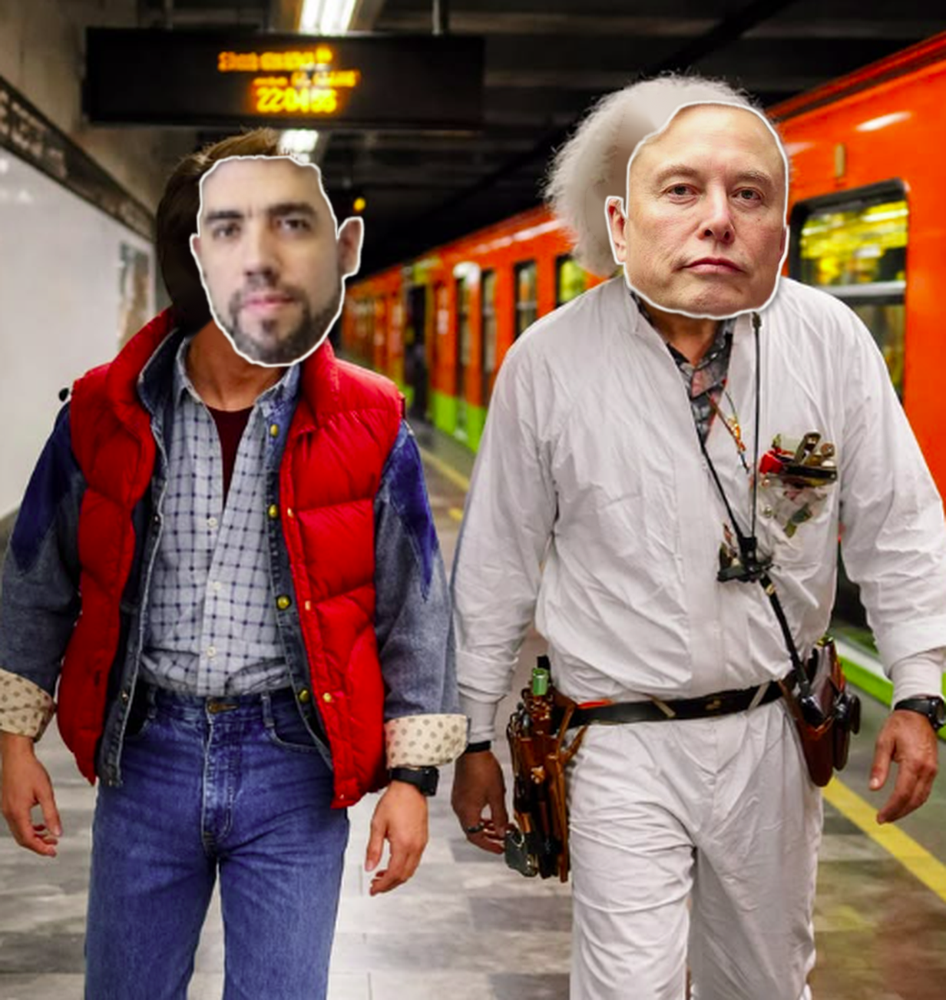
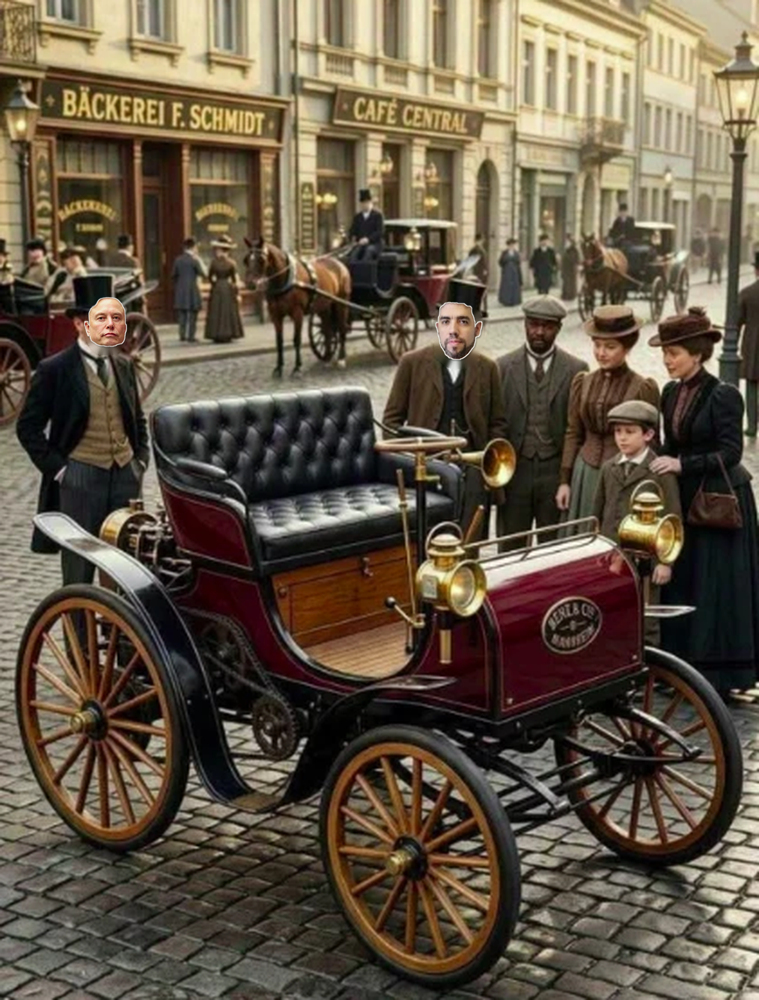

# Personagens — colagem real (corpo de recorte + cabeça verdadeira)

Direção definida pelo solicitante em 19/10: **nada desenhado do zero**. Os personagens são colagens de revista:
o **corpo é recortado de uma foto real** (as imagens de referência enviadas e fotos de época do acervo) e a
**cabeça real do participante** entra no lugar da original, com borda branca de papel recortado.

| Teste | Fonte do corpo | Resultado |
|---|---|---|
| Metrô (dupla da viagem no tempo) | `imagens/referencias-visuais/de-volta-para-o-futuro-referencia.png` |  |
| Rua de 1908 | `imagens/referencias-visuais/pessoas-carro-epoca.webp` |  |

Recortes avulsos (entram e saem de cena): `testes/recorte_metro_gabriel.png`, `testes/recorte_metro_elon.png`.

## Como é feito (`producao/headswap.py`)

1. A foto-fonte é ampliada (2,5–3×) e nitidez leve.
2. Rosto original localizado (detector de rostos; para figuras pequenas, caixa manual no arquivo de job).
3. Rosto original apagado e preenchido (inpaint); cabelo/chapéu/roupa de época **ficam** (`keep_hair`).
4. Cabeça real (recortada por `producao/face_prep.py`) entra alinhada pelo queixo, com escala ~1,3× o rosto
   original (leve exagero de caricatura) e rotação opcional.
5. Saídas: quadro inteiro trocado (`*_frame.png`), recorte corpo+cabeça com borda de papel (`*_flat.png`),
   corpo sem cabeça (`*_body.png`) e `*_meta.json` (ponto do pescoço → a cabeça pode balançar separada do corpo).

Jobs de exemplo: `producao/jobs/metro.json`, `producao/jobs/rua1908.json`.

## Fontes de corpo disponíveis hoje

- Referências enviadas: metrô (2 figuras), rua 1908 (6 figuras), Elon apresentando (meio corpo).
- Acervo licenciado (Adobe Stock, ativos gratuitos já baixados na sessão): 3 soldados c. 1900, operário de
  linha de montagem, homem de chapéu e gravata-borboleta (anos 40), homem de terno (anos 50), multidões.
- **Pendente**: as imagens de corpo "colete vermelho" e "smoking" vieram coladas na mensagem e não como
  arquivo — reenviar como anexo para entrarem no acervo.

## Especificação das fotos dos participantes

- Rosto com **≥ 400 px de altura** (ideal ≥ 800 px). A foto do Gabriel veio com 81 × 105 px e por isso a
  cabeça dele sai borrada nos testes; basta reenviar maior.
- Frontal ou 3/4 leve, olhando para a câmera, expressão neutra ou sorrindo; fundo qualquer (recorte automático).
- Nome do arquivo: `imagens/pessoas/participantes/<primeiro-nome>.png` (sem e-mail, sem sobrenome completo).
- Só entram rostos autorizados (autorização de todos confirmada pelo solicitante em 19/10/2026).
